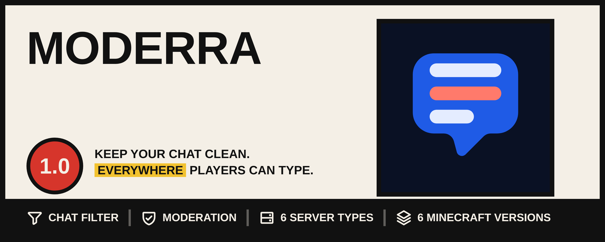
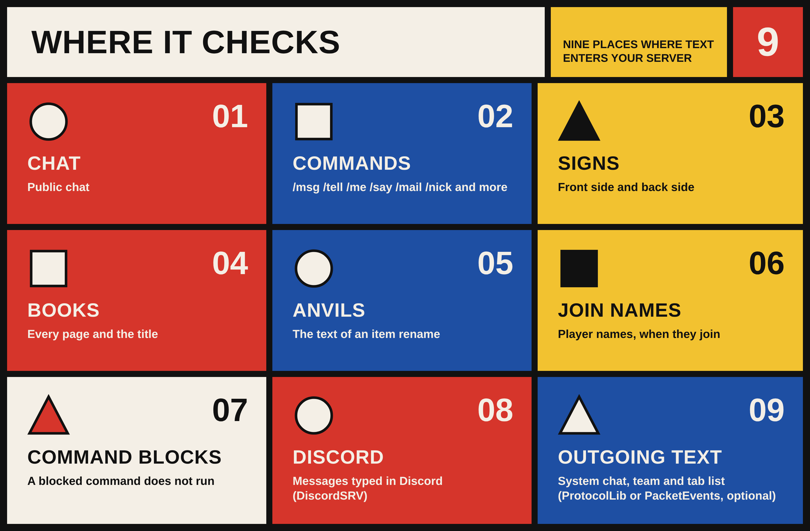
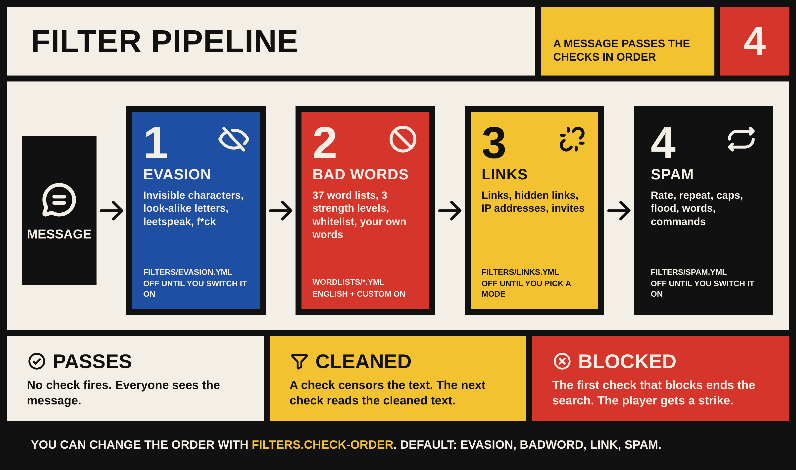
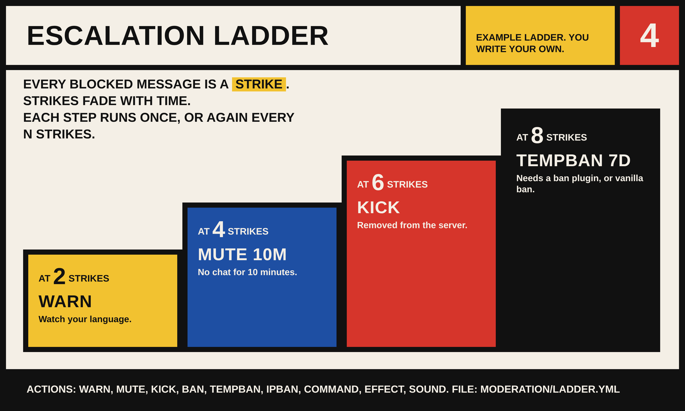
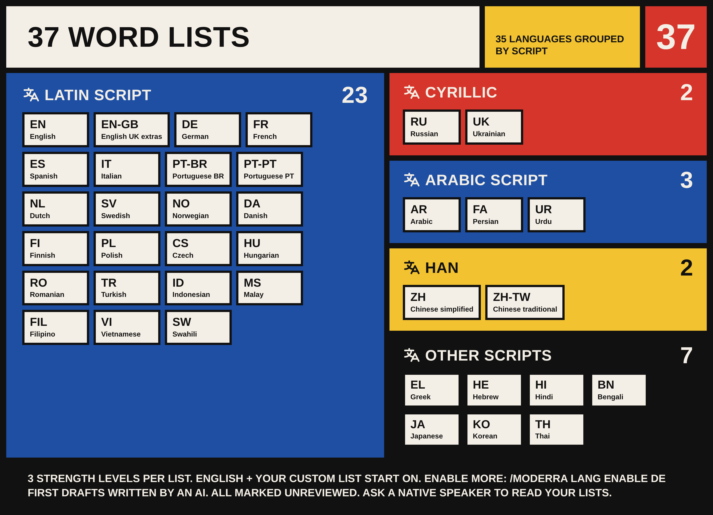
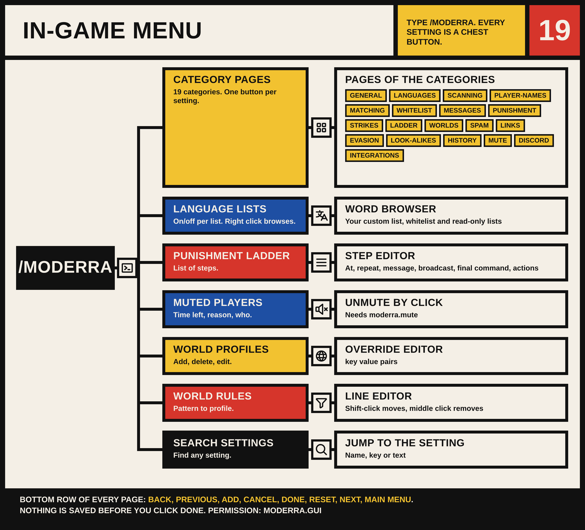
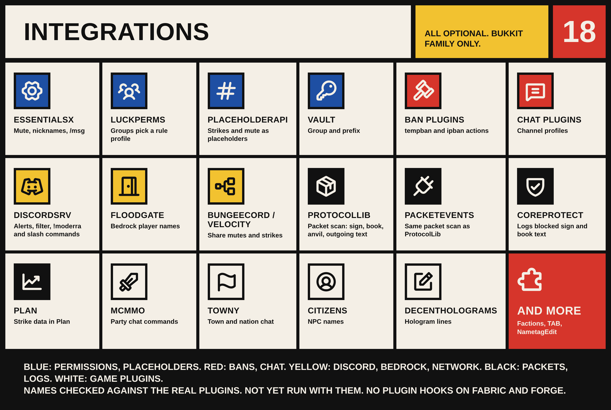
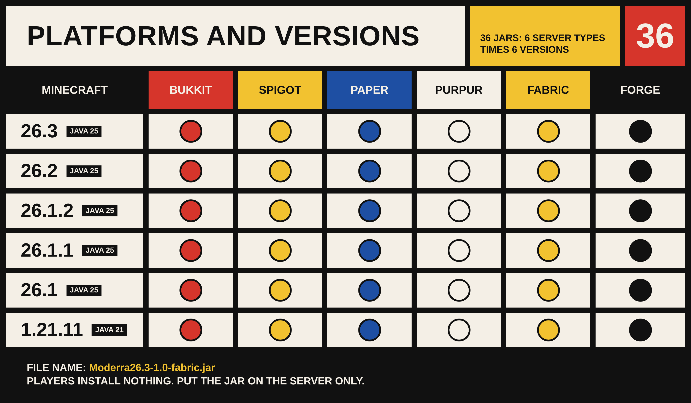

**Moderra keeps your server chat clean.** It blocks bad words before players see them. It warns, mutes, kicks or bans repeat offenders. It works on Bukkit, Spigot, Paper, Purpur, Fabric and Forge.

> **Please read the honest status first.** Version 1.0 is compiled against the real Minecraft, Spigot, Fabric and Forge APIs. Nobody has run it on a live server yet. Please test it on a copy of your world before you use it on your main server. Details are in the section [Honest status](#honest-status).


## Summary

- **Word filter.** 37 word lists, 3 strength levels, a whitelist and your own words.
- **Bypass tricks.** It finds invisible letters, look-alike letters, leetspeak and `f*ck`.
- **Spam and links.** Spam control, a link filter and a player-name check (you switch them on).
- **Checks everywhere.** Chat, commands, signs (both sides), books, anvils, join names and command blocks.
- **Moderation.** Strikes, an escalation ladder, a built-in mute and a history log.
- **Discord.** Webhook alerts on all server types. DiscordSRV features (including slash commands) on the Bukkit family.
- **In-game menu.** Type `/moderra` and change every setting in a chest menu.
- **Integrations.** EssentialsX, LuckPerms, PlaceholderAPI, Vault, ban plugins and more (Bukkit family).
- **Same brain everywhere.** All server types use one shared engine. They make the same decisions.

## What it does

A player types a bad word. Moderra blocks the message. The player gets a strike. At a number of strikes that you choose, the player is punished. You decide what the punishment is.

The plugin starts with safe defaults. English and your custom list are on. Spam, link and bypass-trick filters are off or only note what they see, until you switch them on. After the first start, open `/moderra` and look around.

An old single-file `config.yml` is converted automatically. The plugin keeps a backup named `config.yml.bak-<date>`.

**Upgrading from the project's former name?** Replace the old jar. The old data folder is moved to the new `Moderra` folder on the first start. The command is now `/moderra`. The permissions are now `moderra.*`; the old `antibadwords.*` nodes still work for one major version. Placeholders are now `%moderra_...%`, and the Discord commands are now `!moderra` and `/moderra-...`. The full list is in the changelog.

## Where it checks



| Place | What happens |
|---|---|
| Chat | The message is blocked or cleaned. The player gets a strike. |
| Commands | The text of `/msg`, `/tell`, `/me`, `/say`, `/mail`, `/nick` and more is checked. You can change the list, or scan all commands. |
| Signs | Front side and back side. |
| Books | Every page and the title. |
| Anvils | The text of an item rename. |
| Join names | The player name is checked when the player joins. |
| Command blocks | A command with a blocked word does not run. Bukkit family only. |
| Discord | Messages typed in Discord are checked before they reach Minecraft. Needs DiscordSRV (Bukkit family only). |
| Outgoing text | Text that other plugins send: system chat, player chat, team prefixes and suffixes, and tab-list names. Needs ProtocolLib or PacketEvents (optional, Bukkit family only). Off by default. |

## Filters



A message passes four checks in this order. You can change the order with `filters.check-order`.

1. **Evasion.** Removes invisible characters. Maps look-alike letters and leetspeak back to normal letters. Finds `f*ck`, `f u c k` and `fuuuuuck`.
2. **Bad words.** Compares whole words with your word lists. `class`, `closer` and `cocktail` stay safe. A whitelist protects more words. You can turn on partial matching for strict servers.
3. **Links.** Finds links, hidden links, IP addresses and invites. You choose the mode.
4. **Spam.** Six rules: rate, repeat, caps, flood, words and commands.

The first check that blocks a message ends the search. A check can also clean a message. The next check then reads the cleaned text.

Use `/moderra check <text>` to test a text. The answer names the check that fired.

Speed: in the engine speed test, 99 of 100 messages took less than 0.3 ms with every filter on.

## Moderation



Every blocked message adds strikes. The **escalation ladder** is a list of steps. Each step has a strike number and a list of actions. The picture shows an example. You write your own ladder in `moderation/ladder.yml`.

```yaml
ladder:
  steps:
    warn:
      at: 2
      repeat: once
      actions: [warn]
    short-mute:
      at: 4
      repeat: once
      actions: ["mute 10m Bad language"]
    kick:
      at: 6
      repeat: once
      actions: ["kick Too much bad language"]
    long-ban:
      at: 8
      repeat: once
      actions: ["tempban 7d Repeated bad language"]
```

- **Actions:** `warn`, `mute`, `kick`, `ban`, `tempban`, `ipban`, `command`, `effect`, `attribute`, `sound`, `reset-strikes`.
- **Strikes fade** with time (`strikes.decay`). Strikes can survive a restart.
- **Built-in mute:** `/moderra mute <player> [time] [reason]`. Offline players work too.
- **History:** a log of every event. By default it does not keep the chat text. Old months are deleted after 90 days.
- **Ban plugins:** `tempban` and `ipban` use LiteBans, AdvancedBan, LibertyBans or EssentialsX if found. Minecraft itself cannot ban for a limited time. Without a ban plugin, use the `command` action.
- **Rules per world or group:** `worlds.yml` gives a world, a permission or a group its own rules.

## Languages



The plugin has 37 word lists for 35 languages. They cover Latin, Cyrillic, Arabic, Han, Greek, Hebrew, Devanagari, Bengali, Kana, Hangul and Thai scripts. Every list has three strength levels:

| Level | Meaning |
|---|---|
| 1 | Mild insults |
| 2 | Rude or vulgar words |
| 3 | Severe words |

`filters.protection-level` picks what is used: level 1 uses tier 3 only, level 2 uses tiers 2 and 3, level 3 uses all tiers.

English and your `custom` list start on. Turn on more languages with `/moderra lang enable de`. Add your own words with `/moderra addword <word>`.

**Important:** An AI wrote the first drafts of all lists. A native speaker has not reviewed them. Every list is marked `unreviewed`. Please ask a native speaker to read the lists for your languages. A false-positive test checks normal sentences in all 37 languages, but it cannot replace a human reader.

## In-game menu



Type `/moderra` to open a chest menu. Every setting of every config file is a button. Click to change a value. Click **Done** to save. Nothing is saved before you click Done.

- Pages: categories, language lists, word browser, ladder editor, muted players, world profiles, world rules and a settings search.
- Settings that need text ask you in chat. The answer is not shown to other players and gets no strike. Type `cancel` to stop.
- Permission `moderra.gui` opens the menu. Permission `moderra.gui.edit.<category>` allows changes in one category. Take it away to lock that category.
- Give `moderra.gui` only to people you trust. A change in the menu is as strong as a change in the files.
- On Fabric and Forge, the chest shows names only. It has no description lines yet.

## Discord

Everything is off until you set `discord.enabled: true` in `discord.yml`.

- **Webhook alerts (all server types).** Staff see violations, punishments, mutes, spam and links in a Discord channel. You can use a second channel for a full log. Use `/moderra discord test` to try it.
- **Safe by design.** The plugin never prints the webhook URL. You can keep the URL in an environment variable (`${ENV:NAME}`). Players cannot make the bot ping people. Messages are queued, so Discord rate limits are respected.
- **DiscordSRV (Bukkit family only).** Send alerts through DiscordSRV. Filter what people type in Discord before it reaches Minecraft (block, censor or log only). Run staff commands from Discord (`mute`, `unmute`, `history`, `strikes`, `check`, `reload`) with the prefix `!moderra`, with the slash commands `/moderra-mute`, `/moderra-unmute`, `/moderra-history`, `/moderra-strikes`, `/moderra-check` and `/moderra-reload`, or with both (setting `discord.commands.style: prefix | slash | both`, default `prefix`; restart after you change it). Only listed roles and users can use them. Every command is off by default.
- Fabric and Forge have webhook alerts only.

## Integrations



All integrations are optional. If the other plugin is missing, nothing happens. If something fails, the plugin writes one log line and keeps working. All integration settings are in `integrations.yml`. `/moderra info` lists what the plugin found.

| Plugin | What Moderra does |
|---|---|
| EssentialsX and EssentialsX Chat | Checks chat before Essentials formats it. Checks `/msg`, `/mail`, `/nick` and more. Checks nicknames on join. Can share the Essentials mute. |
| LuckPerms | Chooses a rule profile by group. Knows the permissions of offline players. |
| PlaceholderAPI | Gives placeholders such as `%moderra_strikes%` and `%moderra_muted%`. |
| Vault | Gives the group and prefix when LuckPerms is missing. |
| LiteBans, AdvancedBan, LibertyBans | Run the `tempban` and `ipban` ladder actions. |
| ChatControl, VentureChat, HuskChat, CarbonChat, TownyChat | Channel-based rule profiles. Earlier checks. Some have no usable chat event yet, so only their commands are scanned. |
| Floodgate and Geyser | Handle Bedrock player names. |
| ProtocolLib | Scans packets for signs, books and anvil names when Bukkit events are missing. Optional outgoing scan (system chat, player chat, team and tab-list text). |
| PacketEvents | The same packet scan as ProtocolLib: signs, books and anvil names, and the optional outgoing scan (team and tab-list text). ProtocolLib is used first when both are installed. |
| CoreProtect | Records blocked sign and book text. |
| Plan | Adds strike and mute data to Plan. |
| mcMMO, Towny, Factions, Citizens, DecentHolograms | Check party, town and faction chat commands, NPC names and hologram lines. |
| TAB and NametagEdit | Their commands are scanned like chat. |
| BungeeCord and Velocity | Network sync shares mutes and strikes between servers. Off by default. |

Fabric and Forge cannot see other plugins. They have no plugin integrations. LuckPerms works there through permission nodes.

## Platforms and versions



| Minecraft | Bukkit | Spigot | Paper | Purpur | Fabric | Forge | Java on the server |
|---|:---:|:---:|:---:|:---:|:---:|:---:|---|
| 26.3 | yes | yes | yes | yes | yes | yes | 25 |
| 26.2 | yes | yes | yes | yes | yes | yes | 25 |
| 26.1.2 | yes | yes | yes | yes | yes | yes | 25 |
| 26.1.1 | yes | yes | yes | yes | yes | yes | 25 |
| 26.1 | yes | yes | yes | yes | yes | yes | 25 |
| 1.21.11 | yes | yes | yes | yes | yes | yes | 21 or newer |

That is 36 jars (6 server types times 6 versions). There is no Minecraft 26.0. The 2026 numbering starts at 26.1. Players install nothing. The mod or plugin goes on the server only. Folia is not supported.

## Installation


1. Pick the jar for your server type and your Minecraft version. The name tells you both:
   `Moderra26.3-1.0-paper.jar`
   The name has three parts: `Moderra`, then the Minecraft version, then the Moderra version, then the server type in lower case (`bukkit`, `spigot`, `paper`, `purpur`, `fabric` or `forge`).
2. Use the jar that matches your server software. The four plugin jars contain the same code; they are separate files so that each server type has its own download.
3. Put the jar in the `plugins/` folder (Bukkit family) or the `mods/` folder (Fabric, Forge).
4. Restart the server.
5. Look at the config folder. It is `plugins/Moderra/` or `config/moderra/`. Every file has a comment above every option.
6. Change settings with `/moderra` or edit the files. Then run `/moderra reload`.

On Fabric, the mod asks the Fabric Permissions API for permission nodes (LuckPerms for Fabric uses it). Check on your copy of the server that your permission setup works.

## Commands

Most commands need `moderra.admin`. Operators have it by default. In game, `/moderra` opens the menu. The console gets text help.

| Command | What it does |
|---|---|
| `/moderra` or `/moderra gui [page]` | Opens the settings menu. |
| `/moderra reload` | Reads the config folder again. Shows what is wrong. |
| `/moderra addword <word>` | Adds a word to your custom list. |
| `/moderra removeword <word>` | Removes a word from your custom list. |
| `/moderra listwords` | Shows your words. |
| `/moderra check <text>` | Shows if a text is blocked and which check fires. |
| `/moderra lang list`, `enable <code>`, `disable <code>` | Controls the language lists. |
| `/moderra whitelist add <word>`, `remove <word>`, `list` | Words that are never blocked. |
| `/moderra violations <player>`, `resetviolations <player>` | Shows or clears strikes (classic commands). |
| `/moderra strikes <player>`, `/moderra ladder` | Shows strikes and the ladder. |
| `/moderra mute <player> [time] [reason]`, `unmute <player>`, `mutes` | The built-in mute. Times: `30s`, `10m`, `2h`, `1d`, `perm`. |
| `/moderra history <player>`, `recent`, `purge <player> confirm` | The history log. |
| `/moderra discord test`, `status` | Tests Discord alerts. |
| `/moderra network`, `/moderra info` | Status of network sync and of the plugin. |

## Permissions

| Permission | Default | Use |
|---|---|---|
| `moderra.admin` | op | All admin sub-commands |
| `moderra.notify` | op | See every blocked word |
| `moderra.mute` | op | `/moderra mute`, `unmute`, `mutes` |
| `moderra.history` | op | `/moderra history` (purge also needs admin) |
| `moderra.discord` | op | `/moderra discord` |
| `moderra.gui` | op | Open the settings menu |
| `moderra.gui.edit.<category>` | true | Change that category in the menu |
| `moderra.bypass` | nobody | Never checked |
| `moderra.bypass.spam`, `.links`, `.evasion` | nobody | Exempt from that filter |
| `moderra.bypass.mute` | nobody | Never muted |
| `moderra.profile.<name>` | nobody | Puts the player on that `worlds.yml` profile |

The same defaults apply on Bukkit (`plugin.yml`), Fabric (Fabric Permissions API) and Forge (Forge permission nodes).

## Configuration

The settings are in a folder that looks the same on every server type:

```
config.yml               general: languages, strength, where to look, messages
wordlists/<code>.yml     one file per language, plus custom.yml for your words
moderation/ladder.yml    strikes and the escalation ladder
moderation/mute.yml      the built-in mute
moderation/history.yml   the history log
filters/spam.yml         spam and flood control
filters/links.yml        links, IP addresses, invites
filters/evasion.yml      invisible characters, look-alike letters, leetspeak
filters/confusables.yml  the look-alike and leetspeak tables
worlds.yml               rules per world or group
discord.yml              Discord alerts and commands
integrations.yml         other plugins and network sync
```

Mistakes in a config file never break the server. A wrong value falls back to the default. The plugin reports the file and the key. Messages use a calm, formal style with Minecraft `&` colour codes. Every option has a row in the guide `6-guides/CONFIGURATION.md` in the source repository.

## FAQ

<details>
<summary>Which file do I download?</summary>

Pick the server type and the Minecraft version. Example: `Moderra26.2-1.0-purpur.jar` for Purpur on Minecraft 26.2.
</details>

<details>
<summary>Does it work with my chat plugin?</summary>

It works with the standard chat event. It also has special support for EssentialsX Chat and for some chat-channel plugins. A plugin that sends chat without a chat event cannot be filtered. Test your chat plugin on a copy of your server.
</details>

<details>
<summary>Can staff swear?</summary>

Yes. Give them `moderra.bypass`.
</details>

<details>
<summary>A normal word is blocked. What do I do?</summary>

Run `/moderra check <word>` to see the check that fired. Add the word with `/moderra whitelist add <word>`.
</details>

<details>
<summary>Can I use only my own words?</summary>

Yes. Turn off the languages with `/moderra lang disable en` and add words with `/moderra addword`.
</details>

<details>
<summary>Does it store player data?</summary>

Yes, a little. It keeps strikes, mutes, a list of known player names and the history log in the `data/` folder. By default the history does not keep chat text. The last IP address of a player is kept for IP bans. You can turn it off with `known-players.store-ip`. IP addresses are personal data in many countries.
</details>

<details>
<summary>Does it slow my server?</summary>

The engine speed test shows less than 0.3 ms for 99 of 100 messages with every filter on. This is a test of the engine, not of a live server.
</details>

<details>
<summary>Can I upgrade from the old version?</summary>

Yes. The first start converts your old `config.yml`. The plugin keeps a backup. Check the result and test it.
</details>

<details>
<summary>Why is Discord missing on Fabric and Forge?</summary>

Webhook alerts work on all server types. DiscordSRV is a Bukkit plugin, so its features (Discord chat filter, prefix and slash commands) exist only on the Bukkit family.
</details>

## Honest status


| Check | Result |
|---|---|
| Engine unit tests | **444 tests pass.** |
| All 36 jars built on GitHub against the **real** Spigot, Minecraft, Fabric and Forge APIs | **Yes.** |
| Names of third-party plugins checked against the real jars | **64 names, 0 failures.** |
| A real server started with a version 1.0 jar and `/moderra` commands tried | **Not done.** |
| A scripted player that swears in chat, signs, books and anvils | **Not done in this round.** |
| Any integration tried with the real plugin (EssentialsX, LuckPerms, DiscordSRV and others) | **Not done.** |
| Discord alerts sent to a real Discord | **Not done.** |

**What this means.** The logic has automatic tests. The code fits the real APIs because it compiles against them. Nobody has watched this version work on a live server. The jars of the earlier generation (before the rename) ran on real Fabric and Forge servers, but this code base is a large rewrite.

**What we ask you to do.**

1. Install the jar on a **copy of your world**.
2. Test chat, commands, signs, books, anvils, mute, the ladder and the menu.
3. Test each plugin that you use with Moderra.
4. Ask a native speaker to read the word lists of your languages.
5. Report problems on GitHub.

**Known gaps in version 1.0.**

- The text prompt of the menu (setting `gui.prompt.mode: auto | sign | anvil | chat`): on Fabric and Forge `auto` uses a fake sign; on the Bukkit family `auto` still uses the chat.
- CarbonChat, ChatControl and FactionsUUID events are not used. VentureChat, HuskChat, TAB and NametagEdit have no usable events. The plugin scans their commands only.
- On Fabric and Forge, a censored message becomes a blocked message. Mods cannot change chat text.
- Minecraft 26.2 and 26.3 were never played with the scripted player, even in the earlier generation.

## Licence and support

**All Rights Reserved.** Copyright (c) 2026 Jason P. This replaces the MIT licence of the earlier generation (before the rename). Read the `LICENSE` file in the source repository before you copy or share the files.

- Source code, guides and releases: https://github.com/JasonPieterK/Moderra
- Report a bug or ask a question: GitHub Issues in the same repository.
- Changelog: `CHANGELOG.md` in the repository.
- Test list for real servers: `handoffs/BUILD-VERIFICATION-TODO.md` in the repository.
